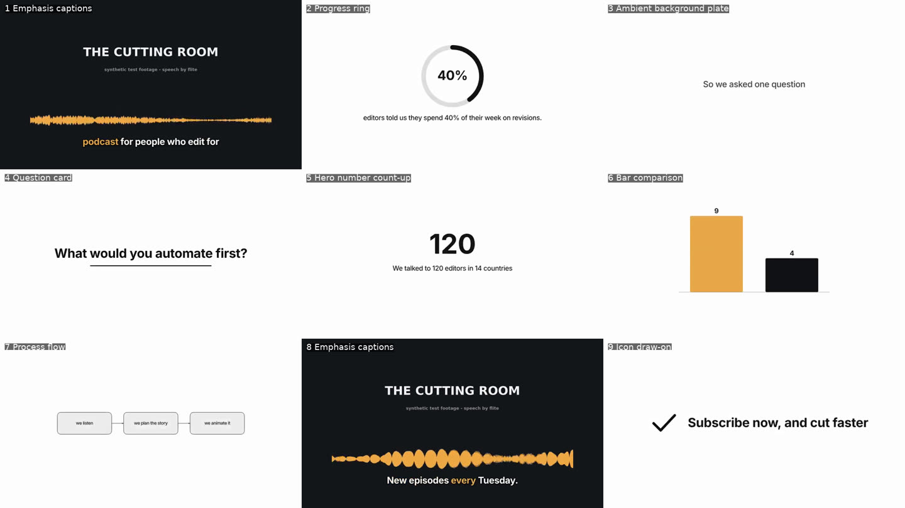

# End-to-end integration (draft)

This branch connects the three engines into one editing workflow inside the existing app:

**import footage → transcribe → suggest visuals → approve → render preview → export → revise**

It runs on the real engines: PR #1's transcription service, PR #2's sandboxed renderer and FFmpeg
pipeline, and PR #3's local deterministic planner. It is not a UI simulation.

| Engine | Branch | Commit integrated |
| --- | --- | --- |
| PR #1 Local transcription | `feature/local-transcription` | `ab032ef` |
| PR #2 Animation & rendering | `feature/animation-rendering` | `178c793` |
| PR #3 Creative planning | `feature/creative-planning` | `3357fa7` |
| #5 Timecode fix (main) | `fix/ntsc-timecode` | `c8a80b2` |

All four were merged into `feature/end-to-end-integration` (from `main` `ec16bac`) with ordinary
merge commits. The first integration merge had no conflicts. Re-syncing on 2026-10-31 resolved
`compose.ts` and `time.ts` in favour of their branches' versions.



## How the pieces connect

```
Renderer (React)                                Main process
────────────────                                ────────────
Workspace / Review / Export
   │  usePipeline (one job at a time, progress, cancel, coded errors; results saved via update())
   │
   ├─ Transcribe ─────── transcription:* ────▶ PR #1 TranscriptionService (FFmpeg → whisper-cli)
   │     transcript → one row per sentence (+ word timing)
   ├─ Link source ────── pipeline:probeSource ▶ FFprobe: duration, exact frame rate, audio
   ├─ Suggest visuals ── pipeline:plan ───────▶ PipelineService → PR #3 PlanningService (local)
   ├─ Approve/Reject/
   │  New idea/concept ─ pipeline:act ────────▶  (plan synced to the rows first, then the decision)
   ├─ Render preview ─── pipeline:build ──────▶  approved plan → PR #2 SequenceSpec (validated)
   │                  └─ render:sequence ─────▶ PR #2 RenderService: renders changed segments,
   │                                              reuses the rest, composites over the source + audio
   └─ Export ─────────── render:sequence (final) → render:export (copy) → pipeline:checkMedia (verify)
```

| New code | What it does |
| --- | --- |
| `src/shared/pipeline/` | IPC contract and pure conversions: sequence rows → planner inputs, plan → row updates, approved plan → PR #2 sequence (composite, alpha or captions). A plan only renders when it matches the row as it is now. |
| `src/main/pipeline/` | `PipelineService` (planning, profiles, sequence building), validated IPC (`pipeline:*`), FFprobe source probing and export checks. |
| `src/renderer/lib/pipeline.ts`, `pages/project/usePipeline.tsx` | Request building, applying results to rows, the job runner (progress, cancel, errors, notices). |
| `src/renderer/components/PipelineStatus.tsx` | Progress bar with Cancel, then the outcome or the coded error. |
| UI changes | Workspace (Transcribe, Suggest visuals, Render preview, Source/Rendered-preview viewer), Inspector (suggestion card: approve, reject, new idea, concept, mode, stale review), sequence table (concept and suggested mode), Review (instruction editing, Regenerate, Update preview), Export (real Start render, verified results, font fallback switch), Direction (variety level). |

The renderer never gets OS access beyond the existing preload bridge. Every `pipeline:*` input is
type- and range-checked. Paths are probed read-only, and only files PR #2 rendered can be exported.

## Step by step: what works end to end (verified on Linux)

1. **Import.** New project, then choose a client preset, then Choose video. The source path is
   stored, not copied. The source is probed, and its exact frame rate (e.g. `30000/1001`) and size
   become the project's timeline when the editor hasn't set them. A moved or deleted file is
   reported before any job starts. The Source tab offers Relink.
2. **Transcription.** The Transcribe button calls PR #1's service over IPC, with progress and
   Cancel. It makes one row per sentence with real sentence timing and word timing. Replacing an
   existing sequence asks first. A file that was transcribed before comes from PR #1's cache
   instantly, so editing the transcript text never re-runs whisper. Errors are coded, e.g.
   `MODEL_NOT_FOUND`, `ENGINE_NOT_FOUND`, `FILE_NOT_FOUND`.
3. **Creative planning.** Suggest visuals runs PR #3's deterministic local planner with the
   project's preset, direction notes and variety level.
   - Each row shows its concept, suggested mode and reasoning.
   - In the inspector, the editor can Approve, Reject, ask for a New idea, pick a concept or change
     the mode.
   - Timestamps, transcript and instructions are never changed by planning.
   - Approving always applies to the suggestion the editor sees. If bringing the plan up to date
     produces a new idea (changed text or instruction, or a rejection), it is shown first and
     approval needs a second click.
   - An approved row whose text or instruction changes keeps its approval but is flagged. It won't
     render until the editor clicks Keep approval or Re-plan with the change.
4. **Animation specs.** Approved rows are converted to PR #2 specs and validated by PR #2:
   - **No code is generated.** The specs are data only; no AI-written JavaScript exists or runs.
   - **Unsupported concepts are flagged, not rendered:** `b-roll-suggestion` (footage) and
     `map-route` (no map component).
   - **Missing data or assets are reported per row,** e.g. no spoken number, or a logo sting
     without a logo.
   - **Brand fonts are strict.** A missing font stops the render with `FONT_NOT_FOUND`, unless the
     project allows a fallback font (Export tab).
5. **Rendering.** Render preview runs PR #2's renderer, with progress and Cancel:
   - It renders approved graphics at preview quality and reuses cached renders of unchanged
     segments.
   - It composites the graphics over the source footage with its audio.
   - The result is saved with the project, so a reopened project still has its preview.
6. **Preview.** The viewer switches between Source and Rendered preview (in Edit and in Review).
   - Graphics start exactly on their segment's frame on the 30000/1001 grid. The E2E test checks
     this by decoding frames: the frame before each graphic is footage, and the first frame of a
     full-frame graphic is the graphic.
   - Source audio is kept as AAC.
   - The preview's frame count matches the timeline exactly.
7. **Export.** Choose an output folder, an output type, then Start render. Every file is copied
   with PR #2's export and then checked with FFprobe (size, frame count, alpha, audio) before
   "Export complete" is shown.

   | Output | What is written |
   | --- | --- |
   | Full motion graphics | One H.264 + AAC MP4: graphics composited over the footage at the export resolution and frame rate. |
   | Transparent motion graphics | One ProRes 4444 MOV with alpha per graphic, named `<name>_<NN>_<HH-MM-SS-FF>.mov` by its timeline position. |
   | Transparent captions | One ProRes 4444 MOV with alpha per segment (word-highlight captions), named the same way with `_captions`. The existing SRT export stays available. |

   Not offered, because the engine doesn't produce it:
   - A single full-length alpha track: alpha is exported per clip, positioned by timecode.
   - A ProRes composite: the composite is H.264. ProRes 422 HQ exists only per segment in PR #2.

8. **Revisions (second priority).** In Review:
   - **Comment.** The editor comments on the segment and marks it for revision.
   - **Instruction.** They edit its instruction in place, e.g. "Show it as bars". PR #3's
     local-edit parser turns plain instructions into concept, mode and pace overrides.
   - **Approve.** They approve the new suggestion.
   - **Update preview.** Only the changed segment re-renders, and every other graphic comes from
     the render cache. The E2E run reports "Rendered 1 graphic(s), reused 8 unchanged from the
     cache".

## Fixes found by the end-to-end run, now in their own branches

The bugs were fixed in their own branches on 2026-10-31, and this branch merges those branches. It
therefore carries the same commits, and merges cleanly whichever lands first.

| Where | Problem | Fix (commit) |
| --- | --- | --- |
| PR #2 `src/main/render/compose.ts` | At NTSC rates a graphic could appear one frame late and lose its last frame. Boundaries were seconds written with 6 decimals, which can round past their own frame (1.064 s at 24000/1001 snaps to frame 26 = 1.0844166…s). | `fcb68d4`: clips are stamped by frame number in the sequence's exact frame time base (`settb=den/num, setpts=N+first`). Real-FFmpeg tests at 24000/1001 and 30000/1001 check every frame. A first attempt on this branch (half-frame offsets) fixed the start but still dropped the last frame; it is replaced. |
| PR #3 `src/shared/planning/adapter.ts` | Caption cues and words could end past the segment after rounding to 0.01 s, so PR #2 rejected the spec (`INVALID_SPEC`). | `922e972`: clamp after rounding (regression test). |
| PR #3 `src/shared/planning/adapter.ts` | Caption highlight used the first brand colour even when near-black, which is invisible on footage. | `922e972`: the first brand colour readable on dark (≥ 4.5:1), else `#ffd166`. |
| PR #3 tests | `tests/fixtures/planning/presets.json` was never committed (`.gitignore` ignores `presets.json`), so planning tests failed on a clean checkout. | `27b2389`: fixture added explicitly. |
| main `src/renderer/lib/time.ts` | Timecode display counted 29.97 as 30 fps, drifting 3.6 s per hour. | [#5](https://github.com/tdk09671-spec/edissistant/pull/5) `c8a80b2`: frames counted at the exact rate, labelled as non-drop timecode. |

**Found in real Windows testing of `6e35122`, fixed in their own branches:**

| Where | Problem | Fix (commits) |
| --- | --- | --- |
| PR #3 adapter + approvals | Picking a concept that doesn't fit the segment's mode (e.g. Kinetic headline on a Captions segment) produced a spec PR #2 rejects. Because a sequence is validated as a whole, no preview rendered. | `3357fa7`: picking a concept brings its own mode, and picking a mode brings its default concept (recorded in history). An explicit impossible pair is refused with the reason. Incompatible plans saved earlier are flagged `incompatible`. |
| PR #4 pipeline | One invalid spec blocked every graphic. | `a780a84`: each spec is validated with PR #2's validator first; a failing one is reported `invalid` and left out, and the rest render (from cache). |
| PR #1 whisperCpp | whisper.cpp ≥ 1.8 turns flash attention on by default, which silently disables DTW. | `dc483e8`: `-nfa` is added with `-dtw` only when `whisper-cli --help` lists it. An unknown flag is handled (exit 0, no output). DTW switched off is reported. |
| PR #1 timing | Sentence starts on whisper's segment boundaries (whole seconds, before the pause), so graphics appeared up to ~0.9 s early. | `651a5f1`, `1f606d8`, `89e0e70`, `ab032ef`: starts pinned to a segment boundary are moved to the speech onset measured in the extracted audio, including quiet lead-in consonants. Estimated segments are spread again. The cache key is bumped. `transcript.timing` records how times were made. |
| PR #4 UI | The missing-font error said "set allowFallback". | `a780a84`: "Install it, or go to Export → Allow a fallback font." |

Integration-only change, which stays in this branch: the PR #3 adapter's `alpha` option, which gives
full-frame graphics a transparent background for graphics-only deliverables.

Planning inputs are built by `toPlanningInputs`, not PR #3's `fromProjectSegments`. The latter
treats an approved row's visual mode as an input, so writing the approved mode back to the row
would make the next run flag the approval as changed.

## Local setup for testing (Windows first)

You need Node 22, then `npm ci` and `npm start` (production build) from the repository.

**FFmpeg and FFprobe** (rendering, composition, probing, audio extraction):
- Use FFmpeg 6 or newer with `libx264`, `prores_ks` and `aac`. `libvpx-vp9` is optional (WebM
  alpha). On Windows, a "full" build from gyan.dev or BtbN works.
- Put `ffmpeg.exe` and `ffprobe.exe` in one folder. Either set Settings → FFmpeg path, or add the
  folder to `PATH`, or copy both into `%APPDATA%\edissistant\bin\`.
- Check from the app's DevTools: `await window.electronAPI.getRenderStatus()`.
- Tested here with FFmpeg 6.1.1 (Ubuntu). The `flite` filter is only needed to generate the
  synthetic test footage.

**whisper.cpp** (as in [TRANSCRIPTION.md](TRANSCRIPTION.md)):
- Unzip a Windows x64 release so that `whisper-cli.exe` ends up in `%APPDATA%\edissistant\whisper\`.
  Or set `"transcription": { "whisperPath": "C:\\…\\whisper-cli.exe" }` in
  `%APPDATA%\edissistant\settings.json`. There are no Settings fields for this yet.
- Put a model in `%APPDATA%\edissistant\models\`. `ggml-base.en.bin` (~142 MB) is fast for clean
  English. `ggml-small.en.bin` (~466 MB) is a good CPU balance.
- **No model is bundled or downloaded by the app.**
- Check from DevTools: `await window.electronAPI.getTranscriptionStatus()`.

**Fonts:**
- Every font named in the client preset must be installed on the render machine. Windows: right-click
  the font file → Install for all users.
- Built-in presets name Inter and Geist, which Windows does not ship.
- To test without them, turn on Allow a fallback font in the Export tab. That also applies to
  Render preview. A generic font is then used and the run says so.

**Footage:**
- 30–60 s with speech. Any frame rate that FFmpeg reads works. 23.976, 24, 25, 29.97, 30, 50 and
  60 are used as-is; other rates are converted to the project rate.

**Synthetic footage for a quick test.** On macOS or Linux (needs FFmpeg with `flite`):

```bash
node tests/fixtures/pipeline/make-trailer.cjs ~/edissistant-trailer
```

This writes a 35.6 s, 29.97 fps trailer with synthesised speech. On Windows, use your own clip
instead.

## Claude: prepared, not called

- `pipeline:plan` accepts `useModel: true`. That routes candidate generation through PR #3's
  `ModelConceptProvider` and `AnthropicTransport`.
- The key is read from the encrypted secrets store per request.
- Model, budget and price come from `%APPDATA%\edissistant\planning\config.json` (see
  [PLANNING.md](PLANNING.md) section H).
- **The UI never sends `useModel: true`.** Every plan in this branch is local and deterministic, and
  no paid call was made.

Still needs a real, approved API run (with a small hard limit in `config.json`):
- That the API accepts the request as built: structured-output schema, effort, refusal-fallback beta.
- Real prompt-cache hit rates, token use and cost per video.
- Real rate-limit behaviour.
- Whether model suggestions beat the local planner. No quality claim is made.
- A UI control to opt into model planning, with the cost estimate shown first. It is not built yet,
  on purpose.

## Tests

```bash
npm run typecheck && npm run test:unit && npm run build && npm run test:e2e
```

**New unit and integration tests (Vitest, `tests/unit/pipeline/`, 34 tests):**

| Area | Tests |
| --- | --- |
| Conversions | rows → planner inputs; word timing kept only while it matches. |
| Plan → rows | status and mode mapping; transcript, timing and instructions never touched. |
| Status → actions | the editor action for each status pick. |
| Approved plan → sequences | composite, alpha and captions sequences validated by PR #2 at 23.976, 25 and 29.97. |
| Stale plans | rows changed since planning are reported, not rendered. |
| Captions | rounding regression; highlight legibility. |
| Composition timing | sweep of 6 rates × 200 clips; NTSC timecode format and parse round-trip over 10 minutes of frames. |
| Media | FFprobe probing (29.97 + AAC, silent footage, ProRes 4444 alpha, broken file, no FFprobe). |
| `PipelineService` | deterministic planning; approvals survive a restart; never approving unseen suggestions; invalid transitions refused; valid PR #2 sequence from approved rows only; selective regeneration (unchanged specs byte-identical, so PR #2 reuses its cache); project notes. |
| Full flow (outside Electron) | media → PR #1 service (real FFmpeg, stand-in whisper) → rows → plan → approvals → validated sequence; transcript cache; missing media and missing model. |

**New E2E tests** (`tests/e2e/pipeline.spec.ts`, real app):

- **The vertical slice:** New project, preset, link footage (29.97 adopted), Transcribe (rows
  match the speech timing to within 20 ms), Suggest visuals, Reject and new idea, approve all,
  Render preview.
  - The preview has AAC audio, frames at 30000/1001, and the exact frame count.
  - Each graphic starts on its frame.
  - All three exports are verified with FFprobe.
  - The app is then closed and reopened, and everything is still there.
  - Review revision: comment, instruction, approve twice, Update preview. Exactly one segment is
    rendered and the rest are reused.
- **Failure paths:** cancel a transcription (nothing changes), `MODEL_NOT_FOUND`, cancel a render
  part-way (no preview saved), and a missing source file.

**The one stand-in:** `whisper-cli` is PR #1's fake engine fed the transcript of the synthesised
speech. That's because there is no model in this container, and Hugging Face is blocked here.
Everything else is real:

- FFmpeg audio extraction from the actual video
- PR #1 sentence grouping and word interpolation
- planning
- the sandboxed Chromium renderer
- FFmpeg encoding and composition
- export copy and FFprobe verification

**Linux results (2026-10-31, from a clean clone of the pushed branch):**
- `npm ci`, typecheck and build pass.
- Unit tests: 429 passed, 2 skipped.
- E2E: 34/34 passed as a normal user.
- As root, PR #1's 4 `launcher.spec.ts` tests fail because Electron refuses root without `--no-sandbox` (details in [TESTING.md](../TESTING.md)).
- Transcription in these tests uses the stand-in `whisper-cli`. Real whisper.cpp was not run here.

## Windows validation checklist (integrated app)

Run these in PowerShell on Windows 11 with the setup above. Record the results in `TESTING.md`.

1. **Automated checks.** `npm ci; npm run typecheck; npm run test:unit; npm run build; npm run test:e2e`.
   - Unit tests should pass.
   - The new `pipeline.spec.ts` skips on Windows: its stand-in engine needs a POSIX shell. Use steps
     2–9 instead.
2. **Real transcription.** Create a project with your client preset and link a 30–60 s clip with
   speech. Click Transcribe. Then check:
   - progress shows
   - the rows match the speech
   - timecodes look right at your clip's frame rate
   - a second Transcribe asks to replace, then finishes instantly (cache)
3. **Plan and decisions.** Click Suggest visuals, then:
   - approve some rows
   - reject one and use New idea
   - change one concept and one visual mode in the inspector
   - check that transcript, in/out and instructions didn't change
4. **Fonts.** With a preset font that isn't installed, Render preview must stop with "A brand font is
   not installed". With Allow a fallback font on, it renders.
5. **Preview.** Click Render preview. Then:
   - play the Rendered preview with sound
   - check each graphic starts with its sentence
   - at 29.97 or 23.976, step frame by frame across a graphic's start
6. **Cancel.** Cancel a render and a transcription part-way. Task Manager must show no `ffmpeg.exe`,
   `whisper-cli.exe` or extra Edissistant renderer process left over.
7. **Export.** Export all three output types to a folder whose name contains spaces and an accent.
   - Open the MP4 in your player and the MOVs in Premiere or Resolve: alpha should be present, and
     clips go at their timecode.
   - Also export the SRT.
8. **Reopen.** Close and reopen the app: the project, its approvals and the preview are still there.
   Move the source file away: Render preview must say it was moved or deleted. Relink it.
9. **Revision.** In Review:
   - comment and mark a segment for revision, then change its instruction
   - approve it (twice: the first click shows the new idea), then Update preview
   - the notice should say 1 rendered and the rest reused

## Known limitations

- The whisper path and models folder are set in `settings.json` (as in PR #1); there are no Settings
  fields yet.
- One job runs at a time per project. Leaving the project cancels a running job.
- Alpha deliverables are one clip per graphic, positioned by timecode in the file name. There is no
  single full-length alpha track and no XML/EDL timeline export yet.
- Planning is local only. Model planning is wired in the main process but has no UI and hasn't been
  validated.
- The E2E vertical slice runs on Linux and macOS only, because of the stand-in whisper-cli.
- Segment ids are random, and they seed the planner's tie-breaking. The same project always plans
  the same way, but two projects with the same transcript can get different (equally valid) concept
  mixes.
