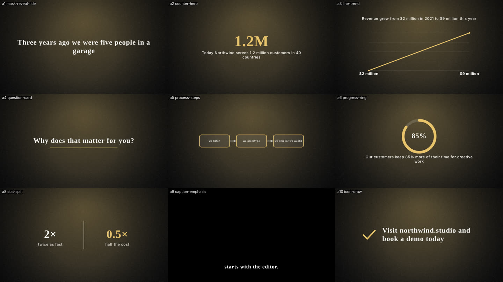

# Creative planning engine

The planning engine turns a transcript and a client's style into a segment-by-segment plan of
on-screen treatments. It sits between transcription (PR #1, `feature/local-transcription`) and
rendering (PR #2, `feature/animation-rendering`):

```
transcript sentences ──► PlanningSegmentInput[] ──► CreativePlanner ──► ProjectPlan (suggestions)
       (PR #1)                                          ▲    │                │
                                       StyleProfile ────┘    │      editor approves / edits / rejects
                                (preset + references)        │                │
                                                     PlanningProvider   planToAnimationSpecs
                                                   (local, or Claude)         │
                                                                    AnimationSpec / SequenceSpec ──► PR #2 renderer
```

Everything is in isolated, strongly typed modules. No UI, IPC, preload or `main.ts` changes were made
in this phase.

Contents: [A. Style profiles](#a-style-profiles) · [B. Planning table](#b-the-planning-table) ·
[C. Variety](#c-deterministic-variety) · [D. Approvals](#d-approval-workflow) · [E. PR #2 adapter](#e-adapter-to-pr-2) ·
[F. Claude provider](#f-claude-provider) · [G. Cost](#g-tokens-and-cost) · [H. Configuration](#h-configuration-no-code-changes) ·
[Local vs Claude](#local-planning-vs-the-claude-api) · [What needs real API testing](#what-genuinely-works-and-what-needs-real-api-testing) ·
[Integration](#integration-requirements-for-pr-1-and-pr-2) · [Windows checklist](#windows-validation-checklist)

| Location | What it is |
| --- | --- |
| `src/shared/planning/` | Pure, deterministic logic: types, style profiles, content analysis, concept library, variety, planner, approvals, local edits, the Claude provider (transport-agnostic), cost tracking, the PR #2 adapter and the integration converters. Runs in the main and renderer processes. |
| `src/main/planning/` | Node-only: `AnthropicTransport` (the SDK call), `analyzeReference` (FFmpeg), `PlanningStore` (JSON on disk), and `PlanningService`, which ties them together. |
| `tests/unit/planning/` | 111 tests: 108 run on main, 2 more once PR #2 is merged, and 1 opt-in test on your own reference video. Fixtures are synthetic and in `tests/fixtures/planning/`. |
| `docs/examples/planning-example.json` | The output of the worked example below. |
| `docs/examples/planning-config.example.json` | A starting `config.json` (section H). |

## A. Style profiles

`buildStyleProfile({ preset, references }, now, previous?)` produces a versioned `StyleProfile`
(schema `edissistant.style-profile`, version 1). The same inputs always give the same profile.

- **Each trait is a `Trait<T>`:** `{ value, confidence, sources, uncertainty }`. Traits cover typography (headline and body font, weight, tracking, fallback), palette (background, text and accents, with contrast checked), background style (`paper`, `cinematic`, `gradient`, `solid`, `transparent`), motion (energy, average shot length, easing, transitions), pacing (graphics per minute), graphic elements, density, rules, `avoid`, and logos.
- **Sources:**
  - Preset fields the editor typed (fonts, tracking such as `+50`, brand colours, creative brief, logo) give high confidence.
  - Reference analysis is evidence, recorded with provenance.
  - Anything inferred says so in `uncertainty`, and the profile lists its uncertainties overall, for example "No reference videos analysed" or "Playfair Display must be installed".
- **Briefs are read with negation.** "No charts" becomes an avoid rule for the data family, not a chart preference. "No bouncy motion" avoids overshoot. "No typewriter" avoids the type-on effect.
- **Revisions:** a profile has a content `fingerprint`. Rebuilding with an unchanged style keeps the revision and `updatedAt`. Any change bumps the revision.
- **Persistence:** `PlanningStore.saveProfile` writes `<userData>/planning/style-profiles/<id>.json` and keeps a bounded history in `<id>.history/rNNNNN.json`. Corrupt files are ignored, and ids are restricted to a safe character set (no path traversal). Profiles are cached, so they are built once per client and reused for every video.

### Reference ingestion (lawful only)

`src/main/planning/referenceAnalysis.ts`:

- **`analyzeReference({ kind: 'local-file', path, role })`** runs on a file the editor already has on disk. It uses FFprobe metadata, FFmpeg scene detection (`select='gt(scene,0.3)',showinfo`) for cuts and shot length, and representative frames from the longest shots. Colour statistics come from downscaled 48×27 RGB frames: dominant colours, luminance, contrast and saturation. Results are cached by file fingerprint (size, mtime and a sample hash). They are re-analysed when the file changes, and the analysis can be cancelled.
- **`ingestLink({ kind: 'link', url })`** stores the link as **metadata only**:
  - It returns `framesAvailable: false` and an explanation, `howToAnalyse`. A YouTube or other URL does not give video frames, and nothing is fetched.
  - To analyse such a video, the editor downloads a copy they have the rights to and adds it as a local file.
  - Non-http(s) and malformed URLs are refused.
- **`ApprovedDownloader`** is an interface only, for a future, explicitly approved source. Nothing implements it, and no platform access controls are touched.
- **Optional vision analysis:** the `PlanningProvider` and model interfaces leave room for a vision pass over the extracted frames. It is **not implemented**, and no paid call is made.

## B. The planning table

`CreativePlanner.plan(request, options)` returns a `ProjectPlan` (schema `edissistant.project-plan`)
with one `SegmentPlan` per transcript segment:

| Field | Meaning |
| --- | --- |
| `segmentId`, `start`, `end`, `text` | Copied from the input unchanged. The planner never edits the transcript or the timing. |
| `inputHash` | A hash of text, timing and instruction. It is used to detect what changed. |
| `suggestion.meaning` | What the sentence is doing (statistic, comparison, process, question, quote, call to action…). |
| `suggestion.treatment`, `visualMode` | `speaker`, `captions`, `motion-graphics`, `background-graphics` or `b-roll`. |
| `suggestion.conceptId` + `params` | One of 22 concepts (see `concepts.ts`). Params hold the headline, emphasis words, numeric values (label, value, unit, context), list items, pace, scale, transition and accent. |
| `suggestion.reasoning`, `varietyNotes` | Why this concept won, and any variety trade-off ("chose a timeline instead of a third bar chart"). |
| `suggestion.transition` | The transition into the segment, drawn from the profile's motion style. |
| `suggestion.requiredAssets` | Assets the concept needs, such as a logo or b-roll. |
| `suggestion.source` | `local` or `model`. |
| `status`, `overrides`, `rejectedConcepts`, `history`, `stale` | See D. |
| `warnings` | Per-segment notes, for example "no spoken number for a counter". |

On-screen text and numbers are always taken from the transcript:

- A headline or list item must be made of transcript words.
- A number must be spoken.
- Anything else (including model output) is dropped, and a warning says so.

The plan also carries `findings`: repetition, pacing and brand issues across the whole video.

## C. Deterministic variety

`variety.ts` chooses one concept per segment from the candidates (from the local heuristics or the
model):

```
score = fit × feasibility + brand fit + novelty + editor preference
        − repetition (same concept within the window) − family repetition
        − share penalty (concept above its max share of the video)
        − client-history penalty (concepts used in this client's recent videos)
        − pacing penalties (too soon after the last graphic, or over the density budget)
        + small seeded jitter (hash of project + segment; reproducible)
```

- **Feasibility:** a data concept scores zero when the data isn't there. A counter needs a spoken number, and a trend line needs two values.
- **Hard rules:**
  - An editor-forced concept always wins.
  - Banned, rejected, avoid-listed and mode-locked candidates are removed.
  - The same graphic is never used twice in a row, unless variety is `low`.
- **Quiet path:** weak fits fall back to a quiet treatment (speaker or captions) rather than forcing a graphic.
- **Levels:**

| Level | Window | Same-concept penalty | Max share of one concept | Novelty | Jitter |
| --- | --- | --- | --- | --- | --- |
| `low` | 2 | 0.15 | 50% | 0 | 0.01 |
| `balanced` (default) | 4 | 0.30 | 30% | 0.03 | 0.03 |
| `experimental` | 6 | 0.45 | 20% | 0.10 | 0.08 |

- **Editor preferences:** `preferredConcepts` (boost), `bannedConcepts` and `forcedConcepts` per segment. A segment input's `visualMode` locks its mode. The pacing target (graphics per minute) comes from the style profile.
- **Client history:** `PlanningStore.recordProjectUsage` stores the concepts approved per client, so the next video for that client leans away from them.
- **`detectRepetition`** reports concepts that are overused within a plan.
- **Determinism:** the same request, profile, history and seed always produce the same plan, byte for byte. Tests check this.

## D. Approval workflow

Segment states are `suggested`, `edited`, `approved`, `rejected` and `needs-regeneration`.
`applyEditorAction(segment, action, at)` applies `approve`, `reject`, `edit`, `request-regeneration`
or `acknowledge-change`. Only valid transitions are allowed, and each one is recorded in `history`
with who did it and when.

**Edits:**
- Edits are stored as `overrides` on top of the suggestion. The suggestion itself is never rewritten.
- `effectiveSegment` merges the two. Overrides accumulate.

**Plain-language edits:**
- `parseLocalEdit("make it a list, slower, accent #ff6600")` turns simple instructions into overrides locally, with no model call.
- It handles concept names, modes, pace, scale, transitions and colours.
- Anything it doesn't understand is returned in `remainder` in the editor's own words.

**Replanning** passes `previous` and only re-plans segments that need it:

| Situation | What happens |
| --- | --- |
| Unchanged segment | Kept byte-identical; no provider call. |
| Approved, and its transcript changed | **The approval and choice are kept.** The segment is flagged `stale` ("changed after approval") and is not rendered until the editor reviews it. `acknowledge-change` keeps the approval and clears the flag, permanently. |
| Approved, and the editor allows replanning (`allowReplan: [id]`) | Replanned; history says "Replanned with editor permission". |
| Edited, and its transcript changed | Overrides kept; status becomes `needs-regeneration` for review. |
| Rejected, or regeneration requested | Replanned; rejected concepts are excluded. |
| Style profile changed | Untouched suggestions are refreshed. Approved and edited segments are never touched. |
| Segment removed or added | Dropped with a finding, or planned. |

## E. Adapter to PR #2

`planToAnimationSpecs(plan, inputs, profile, settings, options)` converts approved segments into
PR #2 `AnimationSpec`s. `toSequenceSpec` collects them into a `SequenceSpec`.

- **No imports of unmerged code.** `compat.ts` mirrors the exact PR #1 and PR #2 field names (`TranscriptSentence`, `AnimationSpec`, `Layer`, `SequenceSpec`, and the component names).
- **Validation against PR #2:** `tests/unit/planning/pr2Compat.test.ts` validates adapter output with PR #2's own validator once it exists in the tree, and is skipped until then.
- **Built from data only:** every spec is declarative JSON built from PR #2 components: `text`, `shape`, `path`, `counter`, `barChart`, `lineChart`, `progress`, `highlight`, `diagram`, `image`, `captions` and `group`. **No AI-generated JavaScript is produced or executed.** The model's output can only choose a concept id from a fixed enum and supply transcript-checked parameters.
- **Styling:** fonts, colours, background and easing come from the style profile.
- **Export mode:** caption-only segments use `transparent-captions`, and graphics over footage use `transparent-motion`. Everything else is `full-motion`.
- **Statuses:** each segment gets a status instead of a spec that pretends to render:

| Status | When |
| --- | --- |
| `renderable` | A valid spec was produced. |
| `no-graphic` | The segment stays on the speaker, or it is b-roll the editor places. |
| `unsupported` | `b-roll-suggestion` needs footage. `map-route` has no PR #2 map component (it would need a map image asset or a new component). Unknown ids also land here. |
| `missing-data` | The concept's data isn't in the transcript: no spoken number, fewer than two values or steps, or no speaker name for a lower third. |
| `missing-assets` | `logo-sting` without a logo file in the preset. |
| `not-approved` | The segment isn't approved, or it is approved but stale. It is only included with `includeUnapproved` for previews. |

**Fonts are strict by default.** `allowFontFallback` defaults to false, so PR #2 fails with
`FONT_NOT_FOUND` if a brand font isn't installed rather than silently substituting one. Pass
`allowFontFallback: true` for previews.

**Verified against PR #2 in a scratch worktree** (not committed):
- PR #2's validator accepted every adapter output (2/2 tests).
- All 9 graphics planned for the `video-a` fixture rendered through PR #2's real renderer, and the 950-frame sequence preview rendered too. The renders used `allowFontFallback`, because the brand fonts aren't installed in the container.



## F. Claude provider

`ModelConceptProvider` (shared and transport-agnostic) plus `AnthropicTransport` (main process,
`@anthropic-ai/sdk` ^1.3.0).

- **Model:**
  - The planning task (`creative-planning`) and the parameter-refinement task (`implementation`) are configured separately. Both default to `claude-opus-5-5`.
  - Effort is `medium` for planning and `low` for refinement.
  - Output uses `output_config.format` with a JSON schema whose `conceptId` is an enum of the catalog.
- **Requests:**
  - Requests use `client.beta.messages.create` with the server-side refusal fallback on by default: `betas: ['server-side-fallback-2026-07-01']`, `fallbacks: 'default'`. Set `refusalFallback: false` to turn it off.
  - Refusals map to `REFUSED`, and `max_tokens` stops map to `TRUNCATED`.
- **Prompt caching:**
  - The frozen instructions and concept catalog are one system block, and the style profile summary is a second. Both are marked `cache_control: ephemeral`.
  - Only the transcript segments vary between calls, so the per-video and per-client prefix is cacheable.
  - Neighbouring context is trimmed to 160 characters per side.
- **Batching:** up to 12 segments per call, with `max_tokens = min(12000, 1500 + 350 × segments)`.
- **Retries:**
  - We own retries; the SDK runs with `maxRetries: 0`.
  - Rate limits honour `retry-after`. Overload (529), 5xx, network errors and timeouts back off exponentially.
  - Auth, permission, not-found and bad-request errors are not retried.
  - Every call has a timeout and an `AbortSignal`. Cancellation stops immediately and is never followed by a fallback.
- **Validation:**
  - Output is parsed and validated: segment ids must match the request, concept ids must be known, and fit must be in 0–1.
  - Text and numbers are rechecked against the transcript.
  - Invalid output is retried once. After that, the provider falls back to local suggestions with a warning, unless `fallbackToLocal: false`.
- **Prompt-injection resistance:**
  - Transcript, reference and instruction text are wrapped in escaped `<transcript_segment>` and similar untrusted tags.
  - The instructions say this is data, not instructions.
  - `findInjection` flags phrases like "ignore previous instructions", and the flagged segment is noted.
  - Because output is limited to an enum and transcript-checked params, an injected instruction can't add text, URLs, code or numbers to a render (tested with `tests/fixtures/planning/injection.json`).
- **Key handling:**
  - `getApiKey()` is called for each request and the key is never cached. In the app it comes from `main.ts` `readSecrets()`, which uses OS-encrypted `safeStorage`.
  - A missing key gives `NO_API_KEY`, and planning falls back to local with "No Claude API key is set". No request is sent.
  - Keys are never logged or written to disk. `redactSecrets` scrubs `sk-ant-…` from every error message, including SDK messages built from the response body.
  - The service test walks every file written and checks that neither the key nor the prompt text appears.

## G. Tokens and cost

- **Saving tokens:**
  - Profiles are built once and cached.
  - The static prompt prefix is cached.
  - Only changed segments are re-planned, and approved or edited segments are never resent.
  - Segments are batched, and output limits are tight.
  - Simple edits are handled locally (`parseLocalEdit`).
  - Local planning is the default and costs nothing.
- **`CostTracker`** records every call: input, output, cache-write and cache-read tokens; task; model; attempt; and the pricing version. Usage is appended to `<userData>/planning/usage/<projectId>.jsonl`, so limits hold across sessions.
- **Pricing:**
  - `DEFAULT_PRICING` (version `2026-10-06`, USD per million tokens) is configurable and versioned.
  - Models missing from the table are counted as unpriced and reported. They are never guessed.

| Model | Input | Output | Cache write | Cache read |
| --- | --- | --- | --- | --- |
| claude-opus-5-5 | 4 | 20 | 5 | 0.20 |
| claude-sonnet-5-5 | 2 | 10 | 2.5 | 0.20 |
| claude-haiku-5-5 | 0.10 | 0.50 | 0.125 | 0.01 |

- **Budgets:**
  - `softLimit` warns once per threshold (`warnAt`, for example 50% and 100%).
  - `hardLimit` blocks any call whose worst case could pass it. Worst case assumes full output and uncached input, and is checked before every attempt, including retries.
- **Reports:** `costReport(projectId)` gives totals by task and by model, the cache hit rate, warnings and a disclaimer.
- **These are estimates, not your bill.** Actual charges come from the Anthropic Console. A `targetPerVideo` (for example $0.10) is only a benchmark the report compares against. **Nothing here assumes $0.10 per video is achievable.** That depends on video length, model, cache hits and how often the editor regenerates, and it hasn't been measured with real calls.

## H. Configuration (no code changes)

Models, limits and prices are read from **`<userData>/planning/config.json`** on every planning run
and every cost report, so a change takes effect on the next run, without rebuilding or restarting.
On Windows the file is `%APPDATA%\edissistant\planning\config.json`. On macOS it is
`~/Library/Application Support/edissistant/planning/config.json`. (If the old `edissisant` data
folder couldn't be migrated, it lives there instead.) Start from
[`examples/planning-config.example.json`](examples/planning-config.example.json):

| Setting | What it changes | Default |
| --- | --- | --- |
| `models["creative-planning"]`, `models.implementation` | Model id per task | `claude-opus-5-5` |
| `effort` (per task) | `low`, `medium` or `high` | planning `medium`, implementation `low` |
| `maxSegmentsPerBatch` | Segments per request (1–50) | 12 |
| `maxOutputTokens` | Upper cap on output per request (256–64000); a request asks for `min(cap, 1500 + 350 × segments)` | 12000 |
| `timeoutMs`, `retry.maxAttempts`, `retry.baseDelayMs`, `retry.maxDelayMs` | Timeouts and retries | 90 s; 3 attempts, 1 s base, 20 s max |
| `refusalFallback`, `fallbackToLocal` | Server-side refusal fallback; local suggestions when the model fails | both `true` |
| `budget` | `softLimit`, `hardLimit`, `warnAt`, `targetPerVideo` for every project (USD estimates) | none |
| `projectBudgets["<projectId>"]` | Replaces `budget` for one project | none |
| `pricing` | A complete, versioned price table that replaces the built-in one | `DEFAULT_PRICING` |

**Order of precedence:**
- The file overrides the code defaults passed to `PlanningService`.
- A per-call budget (`plan(…, { budget })`) can **tighten** the configured hard limit, never raise it, so the renderer can't lift a limit set in the file.
- A model with no price is costed at the most expensive model in the table, so limits still hold after switching models.

**Safety:**
- Every value is validated, and unknown or misspelt settings are errors.
- If the file is invalid, for example broken JSON or `"hardLimit": "one dollar"`, Claude is **not used** until it is fixed. Planning stays local, and the run and the cost report say exactly what is wrong. An invalid file never means "no limits".
- Notepad's "UTF-8 with BOM" and CRLF line endings are accepted.
- **API keys are never allowed in this file.** Any `sk-ant-…` value, or a setting named like a key or secret, makes the file invalid. The key stays in Settings (stored encrypted with `safeStorage`).
- `PlanningStore.saveConfig()` validates before writing, for a future settings screen. `PlanningService.settings(projectId)` returns the effective settings, with no credentials, for display.

## Local planning vs the Claude API

Everything works with no API key and no network. Claude is used only when a run asks for it
(`useModel: true`), a key is set, the config is valid and the budget allows the call.

| Feature | Local, deterministic, free | Needs Claude |
| --- | :---: | :---: |
| Style profiles from presets and briefs (including "no charts" style negation) | ✓ | |
| Reference video analysis: cuts, shot length, frames, colours (FFmpeg) | ✓ | |
| Reading reference frames for style (typography, layout) | | ✓ (vision; **not implemented**, interface only) |
| Content analysis: numbers, units, lists, questions, quotes, comparisons, key phrase | ✓ | |
| Concept candidates per segment | ✓ (heuristic `LocalConceptProvider`) | Optional: `ModelConceptProvider` proposes candidates instead |
| Choosing the concept: variety, pacing, brand rules, client history, editor overrides | ✓ (always local, also for model candidates) | |
| On-screen text and numbers (taken from the transcript and checked against it) | ✓ (always rechecked locally, also for model output) | |
| Approvals, edits, rejections, replanning only changed segments | ✓ | |
| Plain-language edits ("make it a list, slower, accent #ff6600") | ✓ (`parseLocalEdit`) | Instructions it doesn't understand are kept for the editor. Nothing sends them to Claude yet. |
| Refining a concept's parameters (`refineParams`, implementation task) | | ✓ Implemented and tested with mocks, **not called by the planner or service yet** |
| Plan → PR #2 specs, captions, sequence | ✓ | |
| Cost estimates, budgets, reports | ✓ | Measures Claude usage |

What Claude adds is judgement. It reads what a sentence means and proposes concepts beyond keyword
heuristics, which may matter most for abstract or nuanced sentences. It does not decide on its own:
local variety, brand and transcript checks still apply to everything it proposes. How much better
its suggestions are than the local ones **hasn't been measured**, because no paid call has been made.

## Worked example

`tests/unit/planning/integration.test.ts` → "documented example". The output is in
[`examples/planning-example.json`](examples/planning-example.json); regenerate it with
`UPDATE_PLANNING_EXAMPLE=1 npx vitest run tests/unit/planning/integration.test.ts`.

```ts
const profile = buildStyleProfile({ preset }, now);                 // 1. client style (cached)
const segments = fromTranscriptSentences(transcript.sentences);      // 2. PR #1 sentences
const { plan } = await planner.plan({ projectId, profile, segments }, { now });   // 3. suggestions
plan = act('a2', { type: 'approve' });                               // 4. editor decisions
plan = act('a5', { type: 'edit', overrides: { conceptId: 'list-stack', params: { pace: 1.3 } } });
plan = act('a4', { type: 'reject', reason: 'Keep this on the speaker' });
const again = await planner.plan({ projectId, profile, segments }, { now, previous: plan });  // only a4 replanned
const results = planToAnimationSpecs(again.plan, segments, profile, { width: 1920, height: 1080, fps: 25 });
const sequence = toSequenceSpec(projectId, results, { width: 1920, height: 1080, fps: 25 });  // → PR #2
```

## What genuinely works, and what needs real API testing

**Works and is tested (Linux, in this cloud session):**
- **Local pipeline:** profiles, local planning, variety, approvals, replanning, local edits, the adapter, cost tracking and persistence.
- **Reference analysis:** tested with real FFmpeg on a synthetic video.
- **Claude provider and SDK request shape:** tested with a **mocked** transport and a mocked SDK client. This covers request body, caching markers, retries, rate limits, timeouts, cancellation, error mapping, key redaction, refusal and truncation, invalid output and fallback.
- **PR #2 compatibility:** adapter output validated and rendered in a scratch worktree, as above.

**Not proven; needs real API testing with your key and approval:**
- **No paid model has been called. The quality of model suggestions is unproven.** The local heuristics produce the plans shown here.
- **API acceptance:** the request was built against SDK 1.3.0 types, but the API itself hasn't accepted it yet. This covers the structured-output schema (enum size, nesting), `effort`, and the refusal-fallback beta.
- **Prompt caching:** whether the system prefix reaches the model's minimum cacheable size, and real cache hit rates.
- **Cost:** real token counts and the cost per video, and whether the price table matches your Console.
- **Rate limits:** real rate-limit and overload behaviour against your account's limits.
- **Vision:** analysis of reference frames by a model. Only the interface exists.
- **Windows:** reference analysis on Windows paths and the FFmpeg builds there.

A safe first real test, only once you approve one: set `projectBudgets["first-real-api-test"].hardLimit`
to $0.25 in `config.json`, run `PlanningService.plan` with `useModel: true` on one short project with
that id, then compare `costReport` with the Console usage page.

## Integration requirements for PR #1 and PR #2

These were checked against the latest heads of both PRs on 2026-10-29: PR #1
[`143ea40`](https://github.com/tdk09671-spec/edissistant/pull/1) and PR #2
[`343542c`](https://github.com/tdk09671-spec/edissistant/pull/2). Re-check them if either PR gets new commits.

**Merge compatibility:**
- This branch only adds files, apart from four shared edits:
  - `package.json` and `package-lock.json`: one new dependency, `@anthropic-ai/sdk`.
  - `tsconfig.json` and `tsconfig.main.json`: a `src/shared` change that is byte-identical to the one in PR #1 and PR #2.
- A trial merge of main + PR #1 + PR #2 + this branch, in that order, had no conflicts. Typecheck was clean, 336 unit tests passed with 1 skipped, the PR #2 compatibility tests ran and passed, and the build succeeded.
- After the merges, run `npm ci`. If the merged `package-lock.json` is rejected, run `npm install` once and commit the regenerated lock.

### PR #1 (local transcription)

| Requirement | Detail |
| --- | --- |
| Input contract | `TranscriptSentence { id, start, end, text, words: { text, start, end, confidence? }[], edited? }` from `src/shared/transcription/types.ts`. Times are in seconds from the start of the media. `compat.ts` mirrors it field for field (checked at `143ea40`). |
| Conversion | `fromTranscriptSentences(transcript.sentences, clipOffsetSeconds)` → `PlanningSegmentInput[]`. Empty sentences are dropped. Word timings are kept for captions. The editor's text is used as-is. |
| Existing UI segments | `fromProjectSegments(project.segments)`. A stored `visualMode` is only a lock once the segment is approved. |
| Write-back | `toProjectSegmentUpdates(plan)` sets `aiSuggestion` and `status`. It sets `visualMode` only for approved segments (`background-graphics` → `motion-graphics`). It never touches `transcript`, timing or `instruction`. |
| Identity | Plans key on the sentence `id`. Keep ids stable when an editor edits a sentence, so approvals survive. A new id is planned as a new segment. |
| After merge | Replace `TranscriptSentenceCompat` with `import type { TranscriptSentence } from '../transcription/types'`. |

### PR #2 (animation and rendering)

| Requirement | Detail |
| --- | --- |
| Output contract | `AnimationSpec` v1 and `SequenceSpec`, using PR #2's component names. `compat.ts` mirrors them (checked at `343542c`). |
| Validation | `tests/unit/planning/pr2Compat.test.ts` runs PR #2's own validator on adapter output as soon as `src/shared/animation/validate.ts` exists. It has passed 2/2 in both the trial merge and the scratch worktree. |
| Rendering | Pass `toSequenceSpec(...)` to `RenderService.renderSequence(sequence, options, handlers)`, or one `renderable` result to `renderSegment`. From the renderer, use `window.electronAPI.renderSequence(jobId, sequence, options)` (IPC `render:sequence` / `render:segment`). PR #2 validates every spec again. |
| Fonts | Brand fonts must be installed, or PR #2 fails with `FONT_NOT_FOUND` (by design). For previews only, call `planToAnimationSpecs(…, { allowFontFallback: true })`. |
| Unsupported concepts | `map-route` (no map component) and `b-roll-suggestion` (footage) are flagged as `unsupported` and never sent to the renderer. |
| FFmpeg | PR #1 (`src/main/transcription/tools.ts`), PR #2 (`src/main/render/tools.ts`) and `analyzeReference` each need FFmpeg and FFprobe paths. Pass PR #2's `findTools()` result to `analyzeReference` so there is one setting (`ffmpegPath`). |
| After merge | Replace the PR #2 mirrors in `compat.ts` with type imports from `src/shared/animation/types`. |

### Wiring the service

Do this after both PRs are merged; it touches `main.ts` and `preload.ts`.

```ts
// src/main/main.ts
import { PlanningService } from './planning';
const planning = new PlanningService({
  userDataPath: app.getPath('userData'),
  getApiKey: async () => (await readSecrets()).claudeApiKey ?? null,   // never cached, never logged
  // Models and limits come from <userData>/planning/config.json (section H), not from code.
});
ipcMain.handle('planning:plan', (_e, request, opts) => planning.plan(request, opts));
ipcMain.handle('planning:act', (_e, projectId, segmentId, action) => planning.act(projectId, segmentId, action));
ipcMain.handle('planning:cost', (_e, projectId) => planning.costReport(projectId));
ipcMain.handle('planning:settings', (_e, projectId) => planning.settings(projectId));
```

- Validate the IPC inputs, as the existing handlers do.
- Expose the handlers in `preload.ts` next to the existing APIs.
- Pass an `AbortSignal` per job for cancellation, keyed by job id as PR #2 does.
- The renderer never sees the key.
- The existing `settings:save` handler writes `settings.json` only, so it can't overwrite `planning/config.json`.

## Windows validation checklist

The planning engine has only been run on Linux. On a Windows 11 machine, run the steps below in
**PowerShell** from the repository folder and record the results in `TESTING.md` in the same format as
the existing test logs. **No Claude API key is needed, and none should be set for these steps.** Use
synthetic clips or reference videos you own; never commit client media.

**Prerequisites**
1. Windows 11, Node 22.x, Git, and FFmpeg + FFprobe on `PATH`. Record the versions:
   ```powershell
   node -v; ffmpeg -version | Select-Object -First 1; ffprobe -version | Select-Object -First 1; where.exe ffmpeg ffprobe
   ```
2. Check out the branch with a clean install:
   ```powershell
   git fetch origin; git checkout feature/creative-planning; git pull; npm ci
   ```

**Automated checks** (expected results are from Linux)

3. `npm run typecheck` → no errors.
4. `npm run test:unit` → **144 passed, 3 skipped**. The 3 skipped are the 2 PR #2 checks and the opt-in step 7.
5. Reference analysis really ran (not skipped because FFmpeg wasn't found):
   ```powershell
   npx vitest run tests/unit/planning/referenceAnalysis.test.ts
   ```
   → **6 passed, 1 skipped**. This covers a folder with spaces and accents (`Client refs – vidéo`), cut detection within 0.1 s, colour stats, the cache, re-analysis after a file change, and cancellation. If it shows 3 passed and 4 skipped, FFmpeg isn't on `PATH`.
6. No test needs the network or the API. Run the suite with all outbound traffic sent to a closed port, then clear the variables:
   ```powershell
   $env:HTTPS_PROXY="http://127.0.0.1:9"; $env:HTTP_PROXY="http://127.0.0.1:9"; $env:ANTHROPIC_BASE_URL="http://127.0.0.1:9"; $env:ANTHROPIC_API_KEY=""
   npm run test:unit
   Remove-Item Env:HTTPS_PROXY, Env:HTTP_PROXY, Env:ANTHROPIC_BASE_URL, Env:ANTHROPIC_API_KEY
   ```
   → the same counts as step 4.

**Real files on Windows**

7. Reference analysis on a video you own, in a folder whose name has spaces (and ideally an accent):
   ```powershell
   $env:PLANNING_REFERENCE_VIDEO="C:\Users\<you>\Videos\Client refs\reference clip.mp4"
   npx vitest run tests/unit/planning/referenceAnalysis.test.ts --silent=false
   Remove-Item Env:PLANNING_REFERENCE_VIDEO
   ```
   → **7 passed**, and a summary is printed: duration, size, fps, cuts, average shot length, dominant colours, energy and background. Check that the cut count and colours look right for the clip. The cache goes to a temporary folder and is deleted.
8. While step 7 runs, watch Task Manager. Once it finishes, no `ffmpeg.exe` or `ffprobe.exe` should be left running. The cancellation test in step 5 checks the same thing for an aborted run.
9. Paste this into PowerShell to check the config file location and Notepad saving:
   ```powershell
   $dir = "$env:APPDATA\edissistant\planning"; New-Item -ItemType Directory -Force $dir | Out-Null
   Copy-Item docs\examples\planning-config.example.json "$dir\config.json"
   notepad "$dir\config.json"
   ```
   In Notepad, choose **Save as → Encoding: UTF-8 with BOM** and save. Then run:
   ```powershell
   npx vitest run tests/unit/planning/config.test.ts
   ```
   → **12 passed**; the BOM and CRLF case is covered there. Delete `$dir\config.json` afterwards unless you want to keep it.

**App regression**

10. `npm run test:e2e` → **18 passed**, the same as main. This branch doesn't change the UI. Close the app first if it is open.
11. `npm run build` → succeeds, and `dist\shared\planning\index.js` and `dist\main\planning\index.js` exist.

**After PR #1 and PR #2 are merged** (with the merged main)

12. `npm ci; npm run typecheck; npm run test:unit` → the PR #2 checks are no longer skipped:
    ```powershell
    npx vitest run tests/unit/planning/pr2Compat.test.ts
    ```
    → **2 passed**.
13. Fonts: install Playfair Display and Inter, or confirm that a missing brand font fails with `FONT_NOT_FOUND` rather than rendering in another font.
14. Once the service is wired (see "Wiring the service"), plan a short project locally (`useModel: false`) and render it through PR #2. Check that only approved segments render, and that the frames match the contact sheet in section E.

**Not part of this checklist:** any real Claude API call. That needs your explicit approval, a key in
Settings, and a small `hardLimit` in `config.json` (see "What genuinely works").

## Tests

```bash
npm run typecheck && npm run test:unit && npm run build
```

On this branch (Linux):
- Unit tests: 144 passed and 3 skipped. The 3 skipped are the 2 PR #2 checks and the opt-in reference test, which was also run once here with a synthetic clip.
- The suite also passes with the network blocked.
- The existing E2E suite passes 18/18 under `xvfb-run`.
- Typecheck and build are clean.

The tests cover:
- Style persistence and revisions.
- Content-to-concept mapping.
- Diversity and determinism.
- Brand consistency.
- Approval preservation and replanning only changed segments.
- Invalid AI responses and untrusted or injected references.
- The adapter.
- Provider retries and errors.
- Cost tracking and budgets, including a damaged usage log.
- Configuration: validation, live reload, per-project limits, rejecting keys, and invalid files disabling the model.
- Cache reuse and invalidation.
- Cancellation.
- Windows-reserved file names.

Everything was run on Linux only; see the Windows checklist above.
